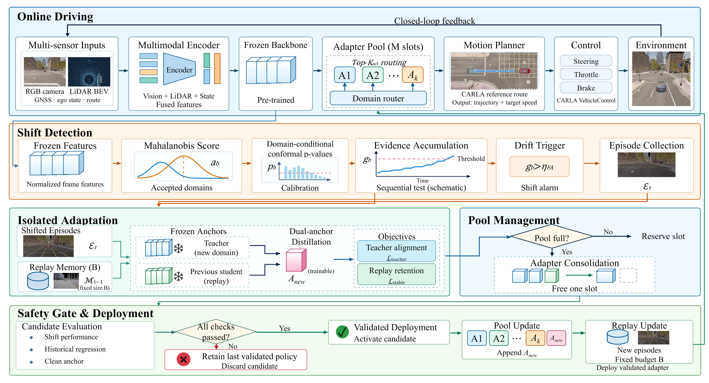
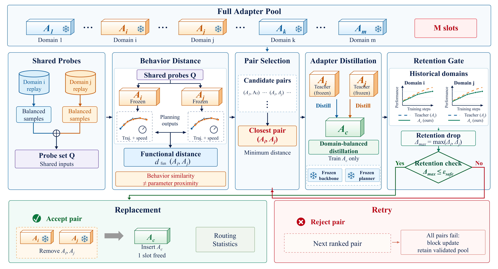
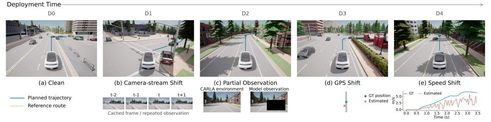

# C3-Drive

**Fixed-capacity continual adaptation for closed-loop end-to-end driving in CARLA**

C3-Drive predicts future waypoints and target speed from RGB cameras, LiDAR, vehicle speed, and route guidance. It detects sustained changes in observations and adapts the planner within a fixed number of adapter slots and a bounded replay memory. A candidate checkpoint replaces the current one only after closed-loop checks on separate routes.

This repository includes route generation, expert data collection, teacher and student training, drift calibration, continual adaptation, and held-out evaluation. The commands below run the released CARLA workflow with self-collected data.

## How it works



A frozen backbone supplies features for sequential drift detection. When the detector triggers, the system trains a candidate using new-domain data and replay from accepted domains. The deployment gate checks for gains on the new domain and bounds regressions on historical domains.

### Reusing adapter slots



When all slots are occupied, C3-Drive ranks adapter pairs by the difference in their planning outputs on shared replay examples. A merge frees a slot only after the merged adapter passes closed-loop regression checks on its source domains. The newly trained policy then faces its own deployment checks.

### Deployment shifts in CARLA



The figure illustrates four perturbations against a clean reference: camera stream disruption, partial observation, GPS localization noise, and ego-speed estimation noise. Use `camera-drop`, `occlusion`, `gps`, and `speed` with the collection and evaluation commands below.

For a full experiment, [run the sequential benchmark](docs/experiments.md) to produce a stage-by-domain score matrix, forgetting and backward-transfer metrics, and a record of each deployment decision. The same guide shows how to evaluate the drift detector offline.

## 1. Installation

Use Python 3.12 and CARLA 0.9.16 with a matching Python wheel. Use a dedicated CARLA instance for collection, adaptation, and closed-loop evaluation. Offline training and calibration can run with CARLA shut down. PyTorch supports both CPU and CUDA.

Run these commands from the repository root in PowerShell. Replace the example CARLA installation path with yours.

```powershell
$env:CARLA_ROOT = "D:\CARLA_0.9.16"
python -m pip install -r requirements.txt
python -m pip install "$env:CARLA_ROOT\PythonAPI\carla\dist\carla-0.9.16-cp312-cp312-win_amd64.whl"
```

Start CARLA from a separate terminal. If you change the default RPC port of 2000, pass the same `--port` to each command that connects to CARLA. [CARLA 0.9.16 downloads](https://github.com/carla-simulator/carla/releases/tag/0.9.16) · [CARLA Python agents](https://carla.readthedocs.io/en/latest/adv_agents/)

```powershell
& "$env:CARLA_ROOT\CarlaUE4.exe" -carla-rpc-port=2000 -RenderOffScreen -nosound -quality-level=Low
```

## 2. Generate routes and collect data

```powershell
python -m c3drive routes --town Town10HD_Opt --routes-per-split 24 --seed 41
python -m c3drive collect --domain clean --splits train validation fit calibrate threshold
python -m c3drive inspect-data --domains clean --splits train validation fit calibrate threshold --output runs/dataset.json
```

Each split draws its start and end points from a separate pool of spawn points. Routes within a town may traverse the same roads. CARLA's BasicAgent drives each route while the collector records sensor observations, route guidance, and expert trajectories. Rerun an interrupted collection command to reuse completed episodes with matching settings. If you change the route manifest, episode length, or traffic settings, use a new data directory and pass it to subsequent commands with `--data`.

| Split | Purpose |
| --- | --- |
| `train` / `validation` | Train both models and select checkpoints by validation loss |
| `fit` / `calibrate` | Fit domain feature distributions and calibrate conformal scores |
| `threshold` | Set the trigger threshold from peak evidence in separate clean episodes |
| `stream` | Monitor deployment routes for sustained drift |
| `gate` | Run closed-loop regression checks for candidate policies |
| `test` | Evaluate frozen policies on held-out routes |

Each NPZ episode contains synchronized observations, route guidance, expert waypoint and speed targets, event labels, and route metadata. To reuse data collected on another machine, copy the episode directory and route manifest. To import other recordings, convert them to the documented schema. [Dataset layout, fields, and import instructions](docs/dataset.md)

## 3. Train the teacher and student from scratch

```powershell
python -m c3drive train-teacher --epochs 30 --output runs/teacher.pt
python -m c3drive train-student --teacher runs/teacher.pt --epochs 40 --slots 2 --output runs/student.pt
python -m c3drive calibrate --checkpoint runs/student.pt --alpha 0.05 --memory-budget 256 --output runs/c3-stage0.pt
```

Both models start from random weights. The teacher uses a wider encoder and GRU and learns expert waypoints and speed. The student learns from expert targets, teacher predictions, and teacher features. Each stage saves the checkpoint with the lowest validation loss. Device selection is automatic by default. Use `--device cuda` to require a CUDA device and adjust `--batch-size` to fit available memory.

The sibling `.latest.pt` file stores the optimizer state, epoch, random states, and the student's feature projection layer. Resume with the same data, device type, teacher weights, and training settings. The epoch argument specifies the total number of epochs.

```powershell
python -m c3drive train-student --teacher runs/teacher.pt --epochs 60 --slots 2 --output runs/student.pt --resume
```

At `--alpha 0.05`, threshold calibration requires at least 19 independent clean episodes with a complete detection block. The default allocates 24 routes to the threshold split. Increase the number of recordings if too many episodes end early.

## 4. Validate a checkpoint

Offline validation scores a teacher, student, or adapted checkpoint against expert trajectories from the validation split. It reports average displacement error (ADE), final displacement error (FDE), speed mean absolute error (MAE), and planning loss. Closed-loop validation drives the CARLA routes in that split and reports completion, collision, and success rates with per-route results.

```powershell
python -m c3drive validate --checkpoint runs/student.pt --output runs/validation-student.json
python -m c3drive validate --mode closed-loop --checkpoint runs/student.pt --domains clean --output runs/validation-closed-loop.json
```

## 5. Run continual adaptation

The example below monitors separate deployment routes for camera dropouts. After a trigger, it trains a candidate using previously collected expert data for that domain and runs regression checks on the gate routes.

```powershell
python -m c3drive collect --domain camera-drop --splits train fit calibrate
python -m c3drive adapt --domain camera-drop --checkpoint runs/c3-stage0.pt --teacher runs/teacher.pt --output runs/c3-stage1.pt --report runs/stage1.json
```

Repeat for `occlusion`, `gps`, and `speed`. Start each round from the latest accepted checkpoint and assign new output and report paths. The report records the decision and available closed-loop metrics. A new checkpoint is written only when the candidate passes the gate. With two adapter slots, adding a third drift domain requires consolidation.

1. Aggregate frozen backbone features into blocks, compute Mahalanobis distances using shrinkage covariance, and accumulate evidence from domain-calibrated conformal p-values.
2. When all slots are occupied, compare pairs of adapters on shared replay examples. Distill a merged candidate with domain-balanced supervision and evaluate it on historical routes.
3. Train the new adapter with expert targets and teacher predictions. Rehearse historical behavior using replay targets and predictions from the previous student.
4. After a candidate passes the gate, rank replay samples by safety severity, critical failures, and retention risk with Pareto sorting. Use k-center selection for feature coverage. The buffer stores fixed-dimensional features and planning labels under a sample budget and reserves at least one representative per accepted domain.

The `adapt` command exposes the gate thresholds. For comparative experiments, set them before reviewing final test results and reuse them across rounds. Each block routes to one adapter based on the best-matching known domain. Merged domains share an adapter while retaining separate calibration statistics.

## 6. Test on held-out routes

Pass the checkpoint you want to evaluate. Closed-loop testing defaults to clean, camera dropout, occlusion, GPS noise, speed noise, and control latency. Use `--domains` to select a subset.

```powershell
python -m c3drive test --checkpoint runs/c3-stage0.pt --output runs/test-stage0.json
```

To evaluate offline, collect expert recordings from the held-out test routes. Use the test split for final reporting after training, calibration, and model selection are complete.

```powershell
python -m c3drive collect --domain clean --splits test
python -m c3drive test --mode offline --domains clean --checkpoint runs/c3-stage0.pt --output runs/test-offline.json
```

Closed-loop evaluation reports per-route results, completion, collision and success rates, and a repository-defined score based on route progress, collisions, and solid-lane crossings. The training workflow uses self-collected CARLA data, a CNN–GRU planner, and the BasicAgent expert. Project organization draws on public driving research repositories. [Bench2Drive](https://github.com/Thinklab-SJTU/Bench2Drive) · [Fail2Drive](https://github.com/autonomousvision/fail2drive)

## Source layout

| File | Purpose |
| --- | --- |
| [`c3drive/__main__.py`](c3drive/__main__.py) | Command-line interface |
| [`c3drive/carla_env.py`](c3drive/carla_env.py) | Routes, sensors, expert collection, perturbations, and closed-loop driving |
| [`c3drive/data.py`](c3drive/data.py) | Episode storage, temporal windows, and input batches |
| [`c3drive/model.py`](c3drive/model.py) | Teacher, compact student, and fixed-capacity adapters |
| [`c3drive/train.py`](c3drive/train.py) | Supervised training, distillation, and checkpoints |
| [`c3drive/evaluate.py`](c3drive/evaluate.py) | Offline planning metrics and per-episode adapter routing |
| [`c3drive/detector.py`](c3drive/detector.py) | Distribution fitting, block calibration, and drift detection |
| [`c3drive/adapt.py`](c3drive/adapt.py) | Dual-anchor training, consolidation, replay, and deployment gate |
| [`c3drive/benchmark.py`](c3drive/benchmark.py) | Sequential deployment, resume, paired test evaluations, and resource accounting |
| [`c3drive/drift_eval.py`](c3drive/drift_eval.py) | Per-episode drift traces and held-out detector evaluation |
| [`c3drive/reporting.py`](c3drive/reporting.py) | Score matrices, retention metrics, and atomic reports |
